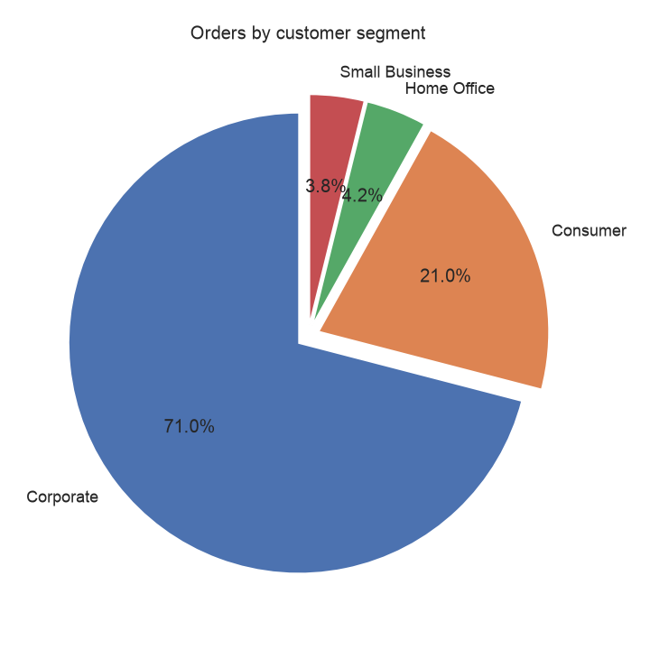
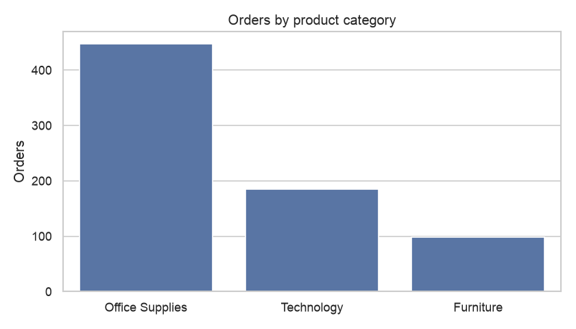
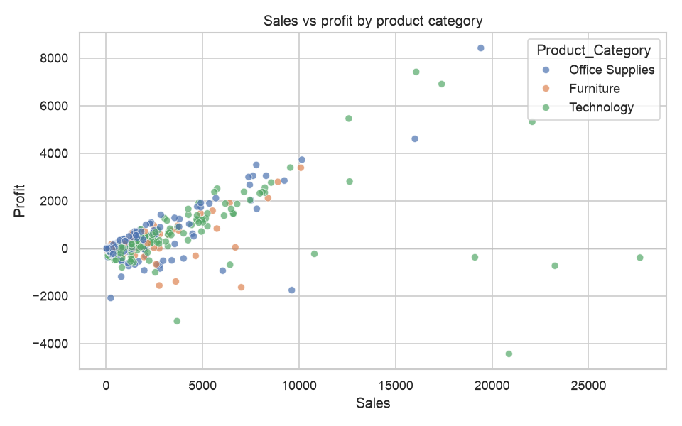
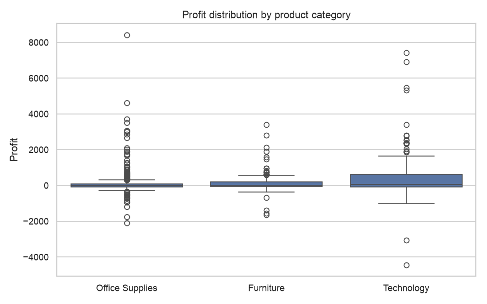
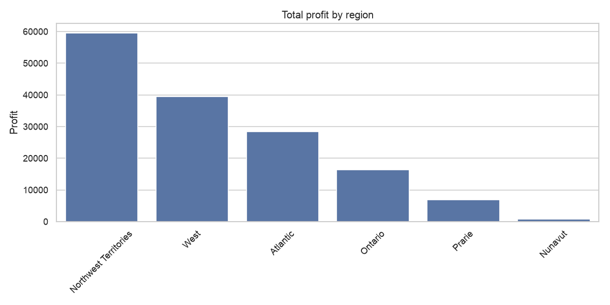
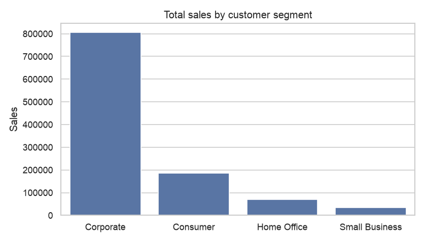

# Sales Store Product Analysis


Exploratory data analysis of a retail store's order data. The goal is to find out **which customers, products and regions drive revenue and profit**, and where the business loses money.

## 📊 Dataset

[`data/sales_store.csv`](data/sales_store.csv) holds one row per order line.

| Attribute | Value |
|---|---|
| Rows | 730 order lines |
| Unique orders | 571 |
| Unique products | 445 |
| Columns | 13 |

**Key columns:** `Order_Priority`, `Order_Quantity`, `Sales`, `Profit`, `Ship_Mode`, `Region`, `Customer_Segment`, `Product_Category`, `Product_Sub-Category`, `Product_Container`

## 🔍 Key findings

1. **Sales and profit move together, but not reliably.** The correlation between them is 0.60, yet **half of all order lines lose money**. Discounting or shipping costs on low-value orders deserve a closer look.
2. **Corporate customers dominate.** They place about 71% of orders and generate about 73% of sales and 79% of profit.
3. **Technology is the most profitable category.** It brings in about 54% of profit from only 25% of orders. Office Supplies has the most orders but lower margins.
4. **Profit is concentrated by region.** Northwest Territories and West together produce about 65% of total profit. Nunavut barely breaks even.
5. **Regular Air is the main shipping mode.** It carries about 79% of orders and a proportional share of profit.

| Segment | Orders | Sales | Profit |
|---|---:|---:|---:|
| Corporate | 518 | 805,343 | 120,106 |
| Consumer | 153 | 186,041 | 18,641 |
| Home Office | 31 | 70,363 | 11,619 |
| Small Business | 28 | 35,280 | 1,093 |

## 📈 Visualizations

| | |
|---|---|
|  |  |
|  |  |
|  |  |

More charts are in [`images/`](images/).

## 📁 Project structure

```text
.
├── data/
│   └── sales_store.csv              # raw dataset
├── notebooks/
│   └── sales_store_analysis.ipynb   # original exploratory notebook
├── reports/
│   └── sales_store_analysis.html    # rendered notebook report
├── src/
│   └── analysis.py                  # reproducible analysis, saves charts to images/
├── images/                          # generated charts
├── requirements.txt
└── README.md
```

## 🚀 Getting started

```bash
git clone https://github.com/codewithgarry/SALES-STORE-PRODUCT-DETAILS-Data-Analytics---Report-.git
cd SALES-STORE-PRODUCT-DETAILS-Data-Analytics---Report-

python3 -m venv .venv && source .venv/bin/activate
pip install -r requirements.txt

# Reproduce the statistics and charts
python src/analysis.py

# Or explore interactively
jupyter notebook notebooks/sales_store_analysis.ipynb
```

## 🛠️ Tech stack

Python · pandas · seaborn · matplotlib · Jupyter

## 👤 Author

**Girish Sharma** · [GitHub](https://github.com/codewithgarry) · [LinkedIn](https://www.linkedin.com/in/codewithgarry/)
